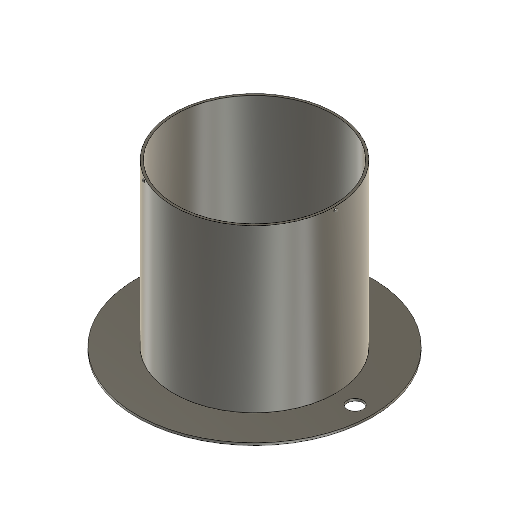
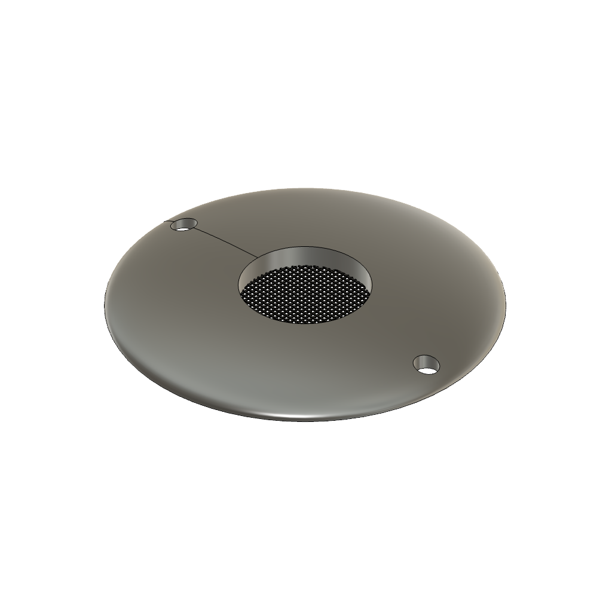

# Airborne Particle Catcher

A 3D-printable Tauber pollen trap for sampling modern pollen rain. The trap is a passive,
unpowered collector: airborne particles settle by gravity through a 50 mm orifice in an
aerodynamically shaped collar and are retained in a thin layer of glycerol at the base of a
cylindrical container. The design replicates the dimensions specified by Tauber (1974) — a
container 100 mm in diameter and 100 mm deep, closed by a collar 150 mm in diameter with a
50 mm orifice — and prints in two parts on a consumer-grade fused deposition modelling (FDM)
printer for a material cost of under AUD 10 per trap.

Version 1.7.

| Base | Collar |
|---|---|
|  |  |

## Download

Two files make one trap. Download both.

| Part | 3MF | STL |
|---|---|---|
| Base | [trap_base_v1.7.3mf](3mf/trap_base_v1.7.3mf) | [trap_base_v1.7.stl](stl/trap_base_v1.7.stl) |
| Collar | [trap_collar_v1.7.3mf](3mf/trap_collar_v1.7.3mf) | [trap_collar_v1.7.stl](stl/trap_collar_v1.7.stl) |

The 3MF files are the originals exported from CAD. The STL files were converted from the 3MF
files and carry identical geometry, recentred on the build plate; both STL files are watertight.
Use the 3MF files where the slicer accepts them, because 3MF stores units explicitly and cannot
be scaled wrongly on import.

To download the whole repository at once, use the green **Code** button above and choose
**Download ZIP**.

## Dimensions

All dimensions are in millimetres, taken from the design files.

### Base

| Feature | Value |
|---|---|
| Internal bore diameter | 100.0 |
| External cylinder diameter | 103.0 |
| Wall thickness | 1.5 |
| Floor thickness | 1.5 |
| Overall height | 104.5 |
| Internal depth above the floor | 103.0 |
| Internal volume | 809 ml |
| Foot flange diameter | 150.0 |
| Foot flange thickness | 1.5 |
| Fixing holes | 2 × 10.0 diameter, on a 128.0 bolt circle, 180° apart |
| Snap lugs | 3 × 1.0 high, at 0°, 120° and 240°, centred 102.5 above the foot |

### Collar

| Feature | Value |
|---|---|
| Outer diameter | 150.0 |
| Orifice diameter | 50.0 |
| Orifice area | 19.63 cm² |
| Rise from rim to orifice | 9.43 |
| Orifice bore depth | 8.6 open, above a 0.8 thick grille |
| Grille | 0.5 bars on a 2.0 pitch, giving apertures of about 1.5 |
| Seating groove | 100.0–103.0 diameter, 2.8 deep, in the underside |
| Fixing holes | 2 × 10.0 diameter, on a 128.0 bolt circle, aligning with the base |

### Assembled

| Feature | Value |
|---|---|
| Overall height | 111.1 |
| Maximum diameter | 150.0 |

The 2.8 mm seating groove in the collar underside is 1.7 mm wide and receives the 1.5 mm wall
of the base, giving 0.1 mm of clearance per side. The three snap lugs on the base engage three
matching pockets in the outer wall of the groove.

### Departures from Tauber (1974)

The grille across the base of the orifice excludes insects and coarse debris and is not part of
the original Tauber design. The grille obstructs part of the orifice and will reduce collection
of the largest particles. Remove the grille from the model, or cut it out after printing, where
comparability with conventional Tauber traps matters more than debris exclusion.

Tauber (1974) describes the collar as aerodynamically shaped and illustrates the profile in
cross-section, but does not specify the curvature mathematically. The collar profile in this
design was drawn to match the illustrated profile by visual comparison.

The base has no drain. In high-rainfall settings the trap will flood, which is the condition
the Gosling funnel trap (Gosling *et al.*, 2003) was developed to avoid.

## Printing

### Material

PETG is the recommended material, for its ultraviolet resistance, mechanical strength and
chemical resistance to glycerol. A six-month deployment of a PETG trap at Canberra, Australia,
produced no warping, cracking, ultraviolet degradation or loss of collar fit.

ASA offers better ultraviolet stability and is worth using for deployments with high
ultraviolet exposure or extreme temperatures. PLA is adequate for indoor testing and for
checking the snap fit, but degrades outdoors and should not be used for field deployment.

### Settings

| Setting | PETG (recommended) | PLA (prototype, as printed) |
|---|---|---|
| Nozzle | 0.4 mm | 0.4 mm |
| Layer height | 0.2 mm | 0.2 mm |
| Wall loops | 3 | 2 |
| Infill | 15% | 15% |
| Nozzle temperature | 240 °C | 220 °C |
| Bed temperature | 80 °C | 55 °C |
| Supports | none | none |
| Brim | 5 mm | 5 mm |

The PLA column records the settings actually used for the prototype prints on a Bambu Lab X1
Carbon with Bambu PLA Basic. The PETG column gives starting values; tune the temperatures to
the filament supplier's figures.

Three wall loops at 0.4 mm produce a wall 1.26 mm thick within the 1.5 mm nominal wall, so the
base prints as very nearly solid regardless of the infill setting. Raise the wall count rather
than the infill percentage if the base feels flexible.

### Orientation

Print the base upright, foot flange flat on the plate. Print the collar with the flat face on
the plate and the dome upward. Neither part needs supports in these orientations: every layer
of the collar is smaller than the layer below it, and the roof of the seating groove bridges a
1.7 mm span.

Printing the collar dome-upward also orients the layer lines circumferentially, parallel to the
direction of airflow across the collar surface.

### Filament use and time

| Part | Filament | Print time |
|---|---|---|
| Base | about 98 g | about 1 h 30 min |
| Collar | about 52 g | about 1 h 30 min |

Figures are from the prototype prints at 15% infill on a Bambu Lab X1 Carbon. At retail PETG
prices of AUD 30–40 per kilogram, the filament for one trap costs AUD 5–6.

### Checking the print

Measure the internal bore of the base and the orifice of the collar before deploying the trap.
Tauber (1974) showed that collection efficiency is proportional to orifice area, so an orifice
printed oversize or undersize changes the catch. A bore or orifice more than 0.5 mm from the
nominal figure means the printer needs calibrating, most often for extrusion width.

## Assembly

1. Remove the brim from both parts and clear any stringing from the orifice grille.
2. Check the three snap lugs on the outside of the base, just below the rim, for blobs or
   stringing. Scrape the lugs clean with a knife, taking off nothing of the lug itself.
3. Align the two fixing holes in the collar with the two fixing holes in the foot flange of the
   base, so that a fixing passed through the collar reaches the flange hole beneath it.
4. Press the collar squarely down onto the base until the three snap lugs click into their
   pockets. Press on the collar rim, not on the dome. The collar is seated when the rim of the
   base reaches the top of the groove and no gap remains at the join.
5. Separate the parts by pulling the collar straight off. The snap join is designed for repeated
   opening at each collection.

Where the snap join is too tight to seat, scale the collar up by 0.2% and reprint it, or sand the
outside of the base rim. Where the join is loose enough to lift off in wind, secure the collar
with the fixing holes as described below.

## Deployment

Mount the trap with the orifice horizontal and clear of overhanging vegetation. The two 10 mm
fixing holes take a bolt, a tent peg or a cable tie through both the collar and the foot flange,
which fixes the trap to its mount and holds the collar down in wind at the same time.

Operate the trap following the standard Tauber protocol: a thin layer of glycerol in the base of
the container forms the trapping surface, and particles settling through the orifice are retained
in the glycerol. Published Tauber trap protocols differ in the depth of glycerol used and in
whether a biocide is added, so follow the protocol of the monitoring programme the data are
intended for. The Pollen Monitoring Programme protocols are the usual reference for European
networks.

At each collection, lift the collar off, recover the glycerol and its contents, rinse the
container, and recharge it with fresh glycerol.

## Citation

Cite the design as:

> Wall A. (2026) Airborne Particle Catcher: a 3D-printed Tauber pollen trap, version 1.7.
> https://github.com/AlexFWall/airborne-particle-catcher

Cite the original trap as:

> Tauber H. (1974) A static non-overload pollen collector. *New Phytologist* 73: 359–369.

## References

Gosling WD, Mayle FE, Killeen TJ, Siles M, Sanchez L, Boreham S. (2003) A simple and effective
methodology for sampling modern pollen rain in tropical environments. *The Holocene* 13: 613–618.

Tauber H. (1967) Investigations of the mode of pollen transfer in forested areas.
*Review of Palaeobotany and Palynology* 3: 277–286.

Tauber H. (1974) A static non-overload pollen collector. *New Phytologist* 73: 359–369.

## Licence

CERN Open Hardware Licence Version 2 – Strongly Reciprocal. See [LICENSE](LICENSE).

Anyone may make, use, modify and distribute the trap. Anyone who distributes a modified design,
or a product made from a modified design, must release the modified design files under the same
licence.

## Problems and improvements

Report a part that does not fit, a dimension that prints wrong, or a field failure by opening an
issue on this repository. Improvements to the design are welcome as pull requests.
